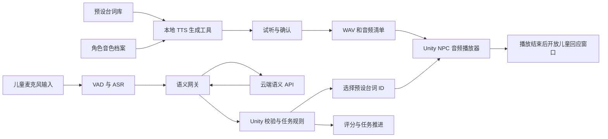
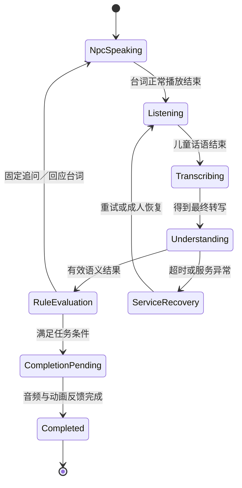

# Lumina：语义理解 API 与本地 NPC 语音生成技术方案

日期：2026-10-13。状态：技术分析与设计交付，尚未实现、安装模型或调用收费接口。

## 1. 结论与需求基线

本方案可行，建议采用两条独立管线：运行时通过云端 API 理解儿童表达；开发或训练准备阶段通过本地 TTS 模型生成已确定的 NPC 台词，试听确认后保存为 Unity 音频资源。语言理解、台词选择、声音生成、任务评分分别负责各自的工作。

用户已明确：

- 语义理解接 API。此前讨论的豆包作为参考接入，不把它视为唯一供应商。
- NPC 语音生成采用本地模型，不采用云端 TTS。
- NPC 台词提前设置，模型只生成声音，不自由生成对话文本。
- 需要调节声音的性别呈现、年龄感和语调等参数。

策划基线为本次用户提供的《游戏一.docx》及其原案流程图，包含自我介绍、打招呼、加入、帮助四个场景。项目中 2026-10-12 的选项改版文档是另一份历史方案，本技术文档不覆盖它、不把其中取消语音输入的规则混入当前语音方案。原案未规定的提示秒数、拾取阈值与儿童语音表现，不在这里写成已确认策划规则。

本次只交付设计文档。代码、场景、Prefab、模型下载、音色录制及部署属于后续实施。

## 2. 当前项目基础与差距

源码核查对象以现有 `Assets/Scenes/SocialEmotion/Scripts` 为准；`PROJECT_CONTEXT.md` 部分条目仍写旧路径 `Level2`。已有代码基础不等同于四场景已完成接线或验证。

### 2.1 可以复用的基础

- `Assets/Scripts/DialogueNode.cs` 已有选项、分支结果、AudioClip、Timeline 和 NPC 动画配置。可复用其资源与反馈方式，另建语音任务配置，不把自由表达硬塞成选项点击。
- `SocialLessonTaskController.cs` 已有 `NpcSpeaking`、`ResponseWindow`、任务完成请求与教师取消入口。
- `TaskNpcSuccessFeedback.cs` 已有面向玩家、动画反馈、播放声音和恢复朝向。
- `LevelTaskSequenceController.cs` 已等待成功反馈回调，再播放星星动画并开放后续关卡。
- `AudioManagerURL.cs` 已演示从 WAV／MP3／OGG 地址取得 AudioClip 并播放，可参考加载模式。
- MediaPipe 负责姿态关键点，动作判断与任务在 Unity 中处理。新增语言管线不改变这个边界。

### 2.2 必须解决的差距

1. `NotifySpeechDetected()` 只把说话事件交给 `HandlePlayerResponse`。在当前说话关卡中，发生说话即可触发完成；它不能表达“说了什么、是否满足目标”。语义校验应建立新入口，不能把所有转写结果直接接到此方法。
2. 当前相关源码中未找到完整的麦克风、VAD、ASR 和云端语义客户端。语义 API 的输入是文字，因此如果目标是实际儿童说话，还需补齐语音转文字；先用人工输入文字验证语义可作为独立阶段。
3. `TaskNpcSuccessFeedback` 播音后等待固定 `successDuration`；`SocialUIManager` 动画反馈等待 `npcAnimationDuration`。不同台词或语速会造成声音还没结束就恢复或切关。需要引入真实播放完成事件。
4. `ConversationLoop` 已参考 `conversationVoice.length` 等待，比固定时长更接近实际，但尚未完整处理暂停、取消、播放失败和输入窗口隔离。
5. 现有四关总控按完成关数增加星星；原案的分任务 L0—L3 奖励应由任务规则扩展，不能由云模型决定。

以上是只读源码结论；本次没有运行 Unity 编译或 Play Mode，也没有实测识别与合成效果。

## 3. 推荐架构与替代路线

### 3.1 推荐：预生成 NPC 音频，运行时只处理语言理解



固定台词生成完成后，TTS 模型不必随游戏运行，模型启动和显卡占用不会进入每次 NPC 回应链路。对于修改语速或音色的台词，重新生成受影响的音频即可。语义 API 仍需要网络；本地 TTS 不意味着整套系统离线。

### 3.2 可选：运行时本地 TTS

仅在确实需要运行时修改台词变量或调音色参数时启用：Unity 选择合法的预设台词／模板，交给独立本地进程，获得声音后播放。进程常驻、限制并发、请求可取消，固定台词优先命中缓存。不能每句话重新加载模型。

这条路线增加模型随包发布、启动检查、音频获取和硬件竞争，当前用户需求不必以它作为第一版。

### 3.3 不采用的路线

云端端到端自由语音对话会让服务同时决定内容和声音，不符合“本地生成声音、台词预先设置”的要求。Unity 主线程内直接运行 TTS 推理会增加卡顿和环境耦合，也不作为推荐实现。

## 4. 语义理解 API 的职责

### 4.1 按当前任务理解，不让模型控制游戏

- 自我介绍：抽取本次实际说出的姓名、年龄、兴趣；信息可跨句累计。
- 打招呼：识别问候表达；挥手仍是 Unity 动作事件，两者按原案的可接受路径处理。
- 加入活动：区分愿意／不愿意／不确定，判断明确请求加入；赞美玩具不直接算加入请求。
- 帮助：识别询问情况、提供帮助、回应感谢；模型不判断是否真正拾取或放置物品。

Unity 合并语言结果与动作／站位条件，管理 L0—L3、完成方式和奖励。拒绝、没有回答、ASR 失败、语义不明确、API 故障是不同状态，不能都合并成“未完成”。

初版意图集合按任务限制：自我介绍为 `self_introduction / unknown`，问候为 `greet / unknown`，加入意愿为 `accept_join / decline_join / unknown`，加入请求为 `request_join / observe / decline_join / unknown`，帮助意愿为 `inquire_problem / offer_help / decline_help / unknown`，感谢回应为 `acknowledge_thanks / unknown`。`unknown` 包含未能明确归类的表达，另用澄清标志区分；没有有效话语不发送模型请求。

多个行为同时出现时，按当前任务的完成目标判断，并保留原文依据；互相矛盾的表达返回不确定，不强行把最后一个关键词当意愿。任务 ID 决定允许标签，不能让其他任务的标签触发本任务完成。

### 4.2 参考供应商接口

豆包参考实现使用火山方舟 Chat Completions：`POST https://ark.cn-beijing.volces.com/api/v3/chat/completions`，采用平台文档对应的鉴权与 `response_format`。模型 ID 配置化，按账号实际可用模型选择。Chat 与 Responses 的字段不能混用。[官方 Chat API](https://docs.volcengine.com/docs/ark/chat-api?lang=zh&redirect=1)、[鉴权说明](https://docs.volcengine.com/docs/ark/base-url-and-authentication?lang=zh)

优先选择支持 `json_schema` 的模型及调用模式，限定意图枚举和字段结构。本地仍做解析和业务校验；合法 JSON 不保证意图正确。该能力目前为 beta，支持列表及限制需在开通时再次核查，不能假定所有模型或所有服务套餐都支持。[官方结构化输出说明](https://docs.volcengine.com/docs/ark/structured-output-beta?lang=zh)

网关隐藏供应商差异，Unity 不依赖豆包特有字段。第一版不需要微调或检索知识库；先用任务规则、少量正反例和真实样例评估。

### 4.3 项目语义请求契约

以下是项目拟定接口，不是供应商原生请求体：

```json
{
  "session_id": "anonymous-session-001",
  "task_id": "join_request",
  "task_epoch": 3,
  "turn_id": "turn-012",
  "npc_id": "child_a",
  "context_revision": 5,
  "transcript": "我也想和你们一起搭",
  "last_npc_line_id": "join_blocks_intro",
  "recent_turns": [
    {"speaker": "npc", "text": "我们正在搭城堡。"}
  ]
}
```

目标标准、允许意图、原文示例和 schema 从网关内版本化任务定义加载，不接受客户端任意改写完成标准。儿童原话只作为数据，不能覆盖系统指令。上下文只保留本任务必要的短历史。

### 4.4 项目语义结果契约

网关校验后返回：

```json
{
  "session_id": "anonymous-session-001",
  "task_id": "join_request",
  "task_epoch": 3,
  "turn_id": "turn-012",
  "context_revision": 5,
  "status": "ok",
  "intent": "request_join",
  "evidence": "我也想和你们一起搭",
  "slots": {},
  "needs_clarification": false,
  "schema_version": "1",
  "prompt_version": "join-v1"
}
```

身份字段由网关从请求封装，不由模型生成。模型只产生意图、信息槽、原文依据和澄清标志。`status` 由服务判定，可为 `ok`、`timeout`、`provider_error`、`invalid_result`；语义不确定使用 `intent: unknown`，与调用失败分开。

本地验证：意图在当前任务允许集合中，依据能对应原话，类型和长度合法，信息只来自本轮或已确认历史。模型不能输出奖励、任意关卡名、执行命令或未经配置的 NPC 台词。模型自报置信度不能作为经过校准的真实概率。

接收时同时检查当前任务、epoch、turn、context revision；旧任务、旧尝试、已经取消或已处理的结果丢弃。重试复用同一个 turn，防止双重评分。

### 4.5 信息累计与自然追问

儿童先说姓名，Unity 记录实际抽取的姓名；尚缺年龄与兴趣时，选择预先设置的年龄追问或兴趣追问台词。后续回答补齐信息，只有达到当前等级对应标准才完成。

姓名和兴趣不会因为成人已有资料就算儿童已经表达。原案 L2 允许模仿或表达相关信息，具体标准需在任务配置中区分，不能强行用 L0 的完整信息标准套所有等级。

预先设置台词不等于每句必须包含儿童姓名。第一版采用固定追问，如“那你今年几岁了呢？”，即可避免运行时动态合成。若需要原案个性化示范，成人在训练准备时填好资料和模板变量，提前生成该儿童的专用音频；不让大模型临时编写内容。

## 5. 本地 TTS 选型与控制边界

### 5.1 主候选：CosyVoice

优先将 CosyVoice 作为中文自然度与表达风格的试听候选，采用适合目标能力的具体版本。官方 CosyVoice3 提供参考音频及指令控制；`inference_instruct2`、`speed` 等入口与旧版 SFT 的 `spk_id` 模式不同，不能把不同版本能力混合承诺。[官方项目](https://github.com/QwenAudio/CosyVoice)、[官方示例](https://github.com/QwenAudio/CosyVoice/blob/main/example.py)

对于需要细调语气的角色，可试 CosyVoice3＋已获授权的角色参考音色；对于只需预设说话人的固定台词，可以试 SFT 模式。模型权重、分词及文本处理资源须完整下载并锁定版本，再验证断网合成。代码和模型许可分别核查，参考声音来源也要可用于该用途。

官方示例包含 Linux wheel 与 NVIDIA Docker 路线，不能当作原生 Windows 一键打包的证据。实施第一阶段先验证本机 Python 推理，遇到依赖不兼容再比较本机 WSL 或轻量备选；不默认要求用户安装这些环境。[官方安装与部署说明](https://github.com/QwenAudio/CosyVoice#install)

### 5.2 轻量备选：sherpa-onnx 中文 TTS

如果 Windows 部署与资源占用比精细语气更优先，可评估 sherpa-onnx 配合中文预训练 TTS。它是推理运行时，不是单一音色模型；具体中文模型的说话人数量、许可与表达控制各不相同。单说话人模型无法满足任意性别年龄切换，必须先试听与核对。[官方 TTS 文档](https://k2-fsa.github.io/sherpa/onnx/tts/index.html)

模型比较依据见 [技术选型依据](./技术选型依据.md)。本次没有合成样音，没有实际 GPU、内存或延迟测量；不能保证某个模型在本电脑实时运行。由于当前台词固定，生成速度主要影响制作效率，不必影响儿童运行时体验。

### 5.3 性别、年龄与语调怎样实现

- **性别呈现**：选择对应的预设说话人或角色参考音色。档案中的“男／女”是筛选标签，不等于向所有模型传一个 gender 参数即可变声。
- **年龄感**：选择并试听成人、青年感或幼龄感音色。数字年龄可作制作备注，但不承诺“设为五岁即可准确合成五岁声音”；提高音高也不等于得到儿童音色。
- **语调／表达风格**：在支持指令的模型中映射为温和、鼓励、疑问等描述；模型效果要逐句试听，不把描述当精确可测控制。原案已有情境台词，第一版不需要情绪识别模型。
- **语速**：使用具体后端支持的速度参数，对同一台词重新生成；UI 允许的范围在实测后确定。使用标点与停顿配置改善理解节奏。
- **音高**：与语调曲线及角色音色不同。若后端没有独立的音高参数，面板标记不支持；可后续加入独立音频处理，但不伪装成模型原生能力。Unity 的 `AudioSource.pitch` 是播放音高控制，不能代替性别、年龄和韵律建模。[Unity 2022.3 文档](https://docs.unity3d.com/2022.3/Documentation/ScriptReference/AudioSource-pitch.html)
- **音量**：生成后统一响度与峰值，再由 Unity 音量控制。不同角色不因生成风格不同产生突兀音量变化。

参数修改后先试听，再批准生成最终资源。后端必须返回支持能力和实际生效参数，不支持的选项禁用或明确报出，不能默默忽略。

### 5.4 角色音色档案

拟建 `NpcVoiceProfile`，记录：角色 ID、后端与模型版本、预设说话人 ID 或参考音频 ID、性别呈现标签、年龄感标签、表达风格、语速、语言、输出音频规格、参数版本和试听批准状态。

例：教师角色可选择成人女性呈现、温和清晰的风格；儿童角色可选择幼龄感呈现。这里只是可配置示例，不预先替用户确定具体性别或音色。

角色音色选择与单句表达分开：同一角色在问句与鼓励句上可有不同表达风格，但不在每次反馈时随机更换音色。

### 5.5 台词与生成清单

拟建 `NpcLineDefinition`：`line_id`、`npc_id`、文字、情境／任务 ID、音色档案引用、单句风格覆盖、版本、生成音频引用、备用音频引用。

本地生成工具接受已经批准的台词和档案，输出完整 WAV 及清单：`line_id`、`voice_profile_id`、实际模型版本、参数摘要、内容 hash、音频 hash、采样率、通道数、时长、生成与试听状态。

缓存键包含规范化文本、模型版本、音色或参考音频 hash、风格、语速、语言、音频规格。改台词或参数时旧音频不再命中。有效音频完成后再更新清单，不把半成品当缓存成功。

第一版优先非流式完整音频合成，更容易审核和导入 Unity。PCM／WAV 单声道为建议交换格式；采样率由模型实际输出确认，如需统一再重采样，不擅自声明所有模型固定 24 kHz。

## 6. 播放、录音与任务时序



该状态图描述单次语音交互，是新增设计，不替换现有控制模式枚举。移动／社交控制模式与语言管线状态分离；交互期间角色保持站定，任务完成或明确取消后恢复移动，不新增“社交中走出小圈”的分支。

### 6.1 必须新增语音转文字入口

`ITranscriptSource` 提供最终话语文本及 utterance ID。第一阶段用人工文字输入测试；实际语音阶段接麦克风、VAD 和中文 ASR。ASR 的供应商／本地模型是独立选型，不因为语义用豆包就自动把音频上传豆包。

建议先评估本地中文 ASR，减少原始儿童音频上传；保持 ASR 与 MediaPipe 的进程或工作队列独立。Unity 可通过 `Microphone.Start` 采集，但 VAD、转写与线程回调仍须实现。[Unity 麦克风 API](https://docs.unity3d.com/2022.3/Documentation/ScriptReference/Microphone.Start.html)

语义只消费最终转写，临时识别文本可显示给成人调试但不触发评分。VAD 结束停顿须可调整，避免把儿童一句话中间停顿拆成多次任务完成。

### 6.2 播放窗口与回声

第一版采用明确轮流说话：NPC 播放时关闭儿童答案提交，播放正常结束后清理上一窗口残留采样，开放新回答窗口。需要等播放后的声学尾音衰减，再提交儿童新话语；具体间隔实测。

这会限制儿童打断 NPC，因此第一版不宣称支持自然打断。未来若需要边播边听，须加入回声消除或耳机／音频参考信号方案，不能只靠关键词过滤。

### 6.3 播放完成与取消

拟建 `NpcVoicePlaybackController`，使用专用对话 AudioSource，提供 `Started`、`Completed`、`Cancelled`、`Failed` 四类事件。音效和 NPC 对话不共享完成判定。

音频与动作成功反馈并行时，以两者都正常结束为完成屏障；之后才显示星星／进入下一步。默认姿态可循环至语音结束。取消、停止或销毁 AudioSource 不得误发正常完成；游戏暂停不能被当作声音结束。

台词找不到或无法加载时播放已确认的本地备用音频；没有备用则报告故障并交成人处理，不能静默通过任务。当前 `successDuration` 可保留为旧功能兼容字段，语音方案不再把它当声音结束条件。

### 6.4 超时与结果竞态

- 转写、语义请求、TTS 制作错误和儿童无回应分别记录。
- 转写和 API 等待期间暂停儿童无回应提示计时；网络延迟不能降低完成等级。
- 同一儿童、同一任务的一次回答按顺序处理；新上下文生成 revision，旧响应无权覆盖。
- 教师取消或重载场景时，取消本地请求、清空音频队列并增加 epoch。远端调用未必能物理停止，但返回结果必须丢弃。
- 原案允许语言或动作完成时，先接受符合当前任务的有效结果，再使其他待处理结果失效；不给同一任务重复发星星。

## 7. 接入模块与拟修改范围

路径均为后续建议，不表示本轮创建了代码。

### 7.1 Unity 新增模块

- `Assets/Scripts/Voice/NpcVoiceProfile.cs`：角色音色档案。
- `Assets/Scripts/Voice/NpcLineDefinition.cs`：固定台词与音频绑定。
- `Assets/Scripts/Voice/NpcVoicePlaybackController.cs`：对话专用播放、取消及完成事件。
- `Assets/Editor/Voice/NpcVoiceAuthoringWindow.cs`：选择档案、修改文字与参数、本地生成、试听和保存。
- `Assets/Scripts/Speech/ITranscriptSource.cs`：最终转写接口；人工输入与真实 ASR 适配。
- `Assets/Scripts/Speech/SemanticApiClient.cs`：向网关提交请求，处理超时及取消。
- `Assets/Scripts/Speech/SemanticResultValidator.cs`：校验 schema、意图、证据及身份。
- `Assets/Scripts/Speech/SpeechTaskAdapter.cs`：将有效语义交给当前任务规则，不直接按发声事件完成。

### 7.2 本地服务与资源

- `Tools/NpcTts`：本地 TTS 生成工具、后端适配和模型清单；采用独立环境，不修改 `Tools/PosePython` 的虚拟环境。
- `Tools/DialogueGateway`：供应商适配、请求校验、限流与错误转换。
- ASR 运行时单独规划资源和环境；不把摄像头线程变成 ASR／API 工作线程。
- `Assets/Audio/NpcVoices`：试听批准的最终音频及台词清单，可作为游戏资源纳入版本控制；模型权重、虚拟环境、未批准音频和缓存不入 Git。
- 新增资源的 `.meta` 由 Unity 正常生成，不手动删除现有 `.meta`。

### 7.3 现有模块适配

- `SocialLessonTaskController`：新增有内容的结果消费入口、语言窗口和等待状态，保留旧行为入口供兼容测试。
- `TaskNpcSuccessFeedback`：等待新播放完成屏障，保持面向玩家和复位逻辑。
- `LevelTaskSequenceController`：继续等待有效反馈完成，再结算任务配置中的奖励；不沿用完成关数作为原案全部评分。
- `SocialUIManager`：仅在实际需要接入同一语音播放器时适配，避免语音方案影响纯选项流程。
- `DialogueNode` 和 `InteractionResultType`：不改变现有枚举数值，不把预设台词方案变成大规模对话资源重构。

场景和 Prefab 在后续接线阶段才修改，先检查当时 Git 状态并说明对象范围。本轮不动这些资源。

## 8. 部署、数据与成本

### 8.1 受控开发电脑与发布版本

开发／实验电脑可运行本地语义网关，在环境变量中配置 API Key。密钥不写进代码、台词清单、日志或 Unity 构建。正式分发给其他电脑时，长期云端密钥应由受控服务器持有，客户端使用项目认证；本地进程或混淆不是可靠的发布版密钥保护。[官方 API Key 管理](https://docs.volcengine.com/docs/ark/manage-api-keys?lang=zh)

本地 TTS 制作服务只绑定回环地址，限制请求和文件访问；模型只从配置的本地资源目录加载。首次下载完成后测试断网生成，不能把自动补下载当作离线支持。

预生成音频的 Windows Player 无需 TTS 模型环境。若未来启用运行时合成，则另行打包 TTS 进程、完整依赖、模型和许可，验证关闭游戏后清理子进程。不能直接把现有 Pose 的 PyInstaller 成功经验当成 CosyVoice 可一键打包的证据。

### 8.2 数据流

本地 TTS 处理预设台词及角色音色，不上传到云端 TTS。语义 API 仍接收儿童转写与必要上下文，涉及姓名时采用最少必要发送；不把完整儿童资料、诊断或视频附在语义请求中。

默认不持续保存原始录音，不将真实儿童文本、个人化示范音频或参考声音提交 Git。评测记录用匿名编号和任务指标；需要保存实际样例时，先明确存储、访问与保留范围。

API 服务的保存／训练使用条款按账号与合同核查，不因本地网关或 HTTPS 就宣称供应商不保存数据。

### 8.3 成本与网络

语义成本按实际输入／输出 token、请求次数、重试和所选模型定价测算，不提供未核查的固定单价。用短上下文、明确输出和按完整话语调用控制成本。

本地 TTS 没有云 TTS 的逐次调用费，但有模型下载、制作时间、磁盘和硬件成本。缓存的固定台词在游戏中可重复播放。

网络检查走用户实际代理路径：核查进程代理配置并使用带代理的 HTTP 请求或官方 SDK 日志，不用原始 TCP 直连结果判断 API 不可用。断网时本地 NPC 音频仍能播放；开放语义任务只能暂停、重试、切成人确认或明确的替代流程，不能假装完成云端理解。

## 9. 分阶段实施与验收

### P0：验证选择，不接场景

核对目标电脑硬件、模型文件和原生 Windows 依赖；当前硬件读取未取得有效信息，方案不假设显卡型号或显存。选择两到三种候选音色，生成教师和儿童各类短台词，试听中文、数字、名字、多音字、疑问和鼓励语气。

验证角色一致性、年龄感是否符合制作要求、参数变化是否确实生效；记录合成时间与资源峰值。试听不过关则换档案或模型，不先做大规模集成。

### P1：语义 API 独立文字验证

用人工确认的文本测试自我介绍、问候、加入意愿、加入请求、帮助和感谢。准备约 100—200 条初始样例，覆盖标准表达、口语、否定、部分信息、含糊、无关表达与多轮补充。测试集留出不参与提示词修改的一部分，按任务统计误接受和误拒绝。

特别测试“不想”不能当同意、“城堡真漂亮”不能直接当请求加入、信息缺失不能补造、API 故障不能当儿童失败。

### P2：本地音频制作与 Unity 播放

接制作工具与台词资源，先完整生成、试听和批准，再导入 Unity。验证变音色或语速后缓存失效、无损坏音频、角色音量一致、长短台词结束回调正确、取消不推进关卡。

### P3：实际语音输入最小闭环

新增麦克风、VAD、ASR，与语义验证串联。先做原案打招呼或加入请求的一个任务，使用已有站定交互与反馈。测试系统声音误识别、儿童停顿、重复回答、成人取消和网络故障。

### P4：四场景规则适配与打包

接信息累计、固定追问、拒绝探索、动作与语言的可接受条件及 L0—L3。最后再接场景对象、NPC 音频和任务顺序，运行 Windows Player 验证。

通过后才将稳定事实写入 `PROJECT_CONTEXT.md`。每阶段以可用闭环验收，不把接口通了就当整套策划完成。

### 建议验收指标

- 语义：分别记录每类 precision／recall、否定误接受、信息槽准确度、澄清比例；不能只报总体准确率。
- 服务：测最终转写到有效语义结果的 p50／p95；可把 p95 不超过 2 秒作为初始体验目标，属于待实测设计目标，不是供应商承诺。
- TTS：固定短台词人工核对无漏字、重复或明显错读；角色音色与期望的年龄感通过试听；风格和语速变化可复现。
- 运行：预生成音频的回应不等待 TTS 推理；Unity 与姿态管线联合测试不产生明显新增卡顿。
- 状态：重复请求、取消、重载、暂停、旧结果、播放失败均不得导致错误通关或重复发奖。
- 工程：C# 编译、必要接口与状态测试、Editor 试听、Play Mode 及 Windows Player 均完成；本轮设计文档未执行这些实现验收。

## 10. 当前设计决定与实施前参数

已经确定的架构：云端语义 API；本地 TTS；预设台词；固定音频优先预生成；角色音色档案与台词分离；Unity 控制任务规则及评分。

实施前需要落实的是具体 API 账号／模型、ASR 后端、目标电脑硬件、角色音色和参考声音来源、所用 TTS 版本与输出规格。它们影响安装和实测，不阻碍当前架构分析；本方案不替用户购买服务、下载安装环境或默认录制音色。

本轮文档完成后，可据此审阅并安排 P0—P1。游戏代码与资源实施范围需另行确认。
